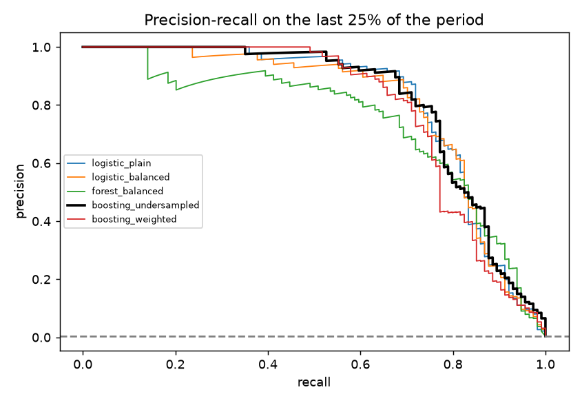

# fraud-detection

Card fraud detection on highly imbalanced data: time-based split, class weights, undersampling, precision at an alert budget.

## Task

Catch rare fraud without flooding analysts with false alarms.

## Approach

- About 0.4% of transactions are fraud; fraudulent ones differ in amount, hour, distance from home, velocity, card age, merchant and channel.
- The split is by time: train on the first 75% of the period, test on the last 25%.
- Strategies: plain and class-weighted logistic regression, class-weighted random forest, gradient boosting with undersampling and with class weights.
- Metrics suited to imbalance: PR AUC and precision and recall within an alert budget (the top 0.5% of transactions), plus the threshold that gives 80% precision.

## Results



- 120,000 transactions, fraud rate 0.39%, 114 fraud cases in the test period.
- PR AUC: boosting_undersampled 0.813, logistic_plain 0.809, logistic_balanced 0.798, boosting_weighted 0.787, forest_balanced 0.744.
- Best by PR AUC: `boosting_undersampled`. At 80% precision it keeps recall of 74%.

With only about a hundred fraud cases in the test period, the differences between the top models are within noise. The generated fraud is also easier to separate than real fraud.

## Run

```bash
pip install -r requirements.txt
python run.py      # generates data, runs the analysis, writes reports/
pytest             # unit tests
```

## Layout

```
src/data.py     data generation (fixed seed, no downloads)
src/core.py     analysis / model code
run.py          end-to-end script
tests/          unit tests
reports/        figures and summary.json produced by run.py
```

## Notes

The data is generated by `src/data.py` with a fixed random seed, so the numbers above are reproducible. It is synthetic: it is meant to show the method, and results on real data will differ.

Stack: pandas, scikit-learn, matplotlib.
